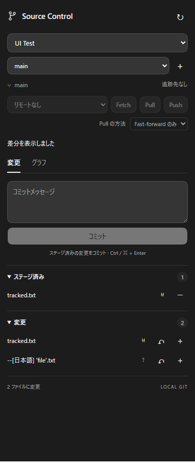
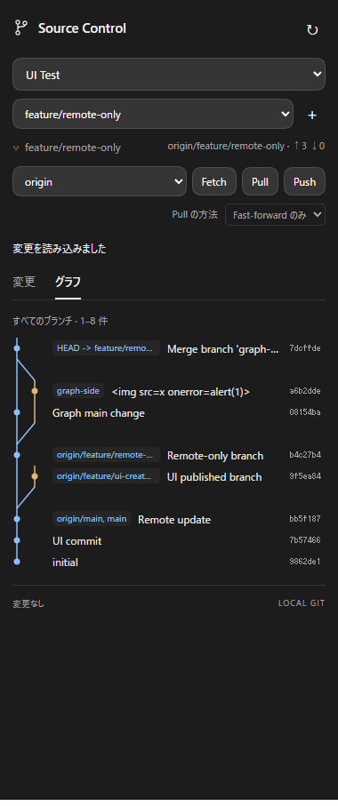

# Git Source Control for Codex

Codex desktop のサイドバーから使える Git プラグイン。VS Code の Source Control に近い操作を、日本語のパネルにまとめています。

## 機能

- 変更ファイル一覧、staged / unstaged の区別、stage / unstage
- コミットメッセージ入力と commit（Ctrl / Command + Enter）
- 確認付き discard。ステージ済み内容を保持し、未追跡ファイルは削除
- ローカル／リモートブランチの切り替え、新規ブランチ作成、worktree の表示
- リモート選択、Fetch、Pull、確認付き Push、ahead / behind 表示
- Pull の Fast-forward / Merge / Rebase 選択、競合解決後の継続・中止
- 全ブランチのコミットグラフ、履歴のページ送り、コミット詳細
- ファイルごとの staged / unstaged 差分表示
- Codex のライト／ダークテーマ、フォントに追従

| 変更 | グラフ |
| --- | --- |
|  |  |

## インストール

必要なもの: Node.js 22 以上、Git、プラグイン拡張に対応した Codex desktop / CLI。

PowerShell:

```powershell
git clone https://github.com/JiloTage/git-source-control.git
cd git-source-control
npm --prefix ./git-source-control ci --omit=dev
Copy-Item ./git-source-control/repositories.example.json ./git-source-control/repositories.json
```

`git-source-control/repositories.json` を編集し、使用するリポジトリの **ルートの絶対パス** を指定してください。複数登録できます。JSON の Windows パスには `/` または `\\` を使用します。

```json
[
  { "id": "app", "label": "My app", "path": "C:/Projects/my-app" },
  { "id": "docs", "label": "Docs", "path": "C:/Projects/docs" }
]
```

設定後、クローンしたフォルダーで実行します。

```powershell
codex plugin marketplace add .
codex plugin add git-source-control@git-source-control
```

Codex を再起動し、サイドバーまたは会話のパネル一覧から **Source Control** を開きます。UI は同梱済みなのでインストール時のビルドは不要です。

設定やコードの変更後は `codex plugin add git-source-control@git-source-control` を再実行して Codex を再起動してください。インストールされたコピーは元フォルダーと自動同期しません。`repositories.json` は Git の管理対象外です。

## 操作

リポジトリを選び、ファイル名で差分を確認。`+` でステージし、メッセージを入力してコミットします。ブランチ一覧のリモートブランチを選ぶと、追跡するローカルブランチを作成して切り替えます。同名のローカルブランチがある場合はローカル側を選んでください。

Fetch はリモート参照を更新します。Pull は変更をコミットまたは退避してから実行します。既定は Fast-forward のみ。Push は送信先を確認して実行し、初回は追跡先を設定します。競合が発生したらエディターで解決し、ステージして「継続」、または確認後に「中止」します。

`↻` で手動再読み込み。表示後にファイル・参照・リモート設定が変わっていた場合、書き込みは拒否します。登録したリポジトリだけを操作できます。認証は端末の Git / SSH 設定を使い、対話式の認証入力は無効です。

サブモジュールのファイル操作はそのリポジトリ内で行ってください。差分表示は先頭 200,000 文字まで。強制 Push と自動ファイル監視は含みません。

## 開発とテスト

```powershell
cd git-source-control
npm ci
npm run build
npm test
```

UI テストは Playwright と Chromium を使います。既存のパッケージとブラウザーのパスを指定できます。

```powershell
$env:SOURCE_CONTROL_PLAYWRIGHT = 'C:/path/to/node_modules/playwright'
$env:SOURCE_CONTROL_CHROMIUM = 'C:/path/to/chrome.exe'
npm run test:ui
```

テストは一時的なローカルリポジトリと bare リモートを使います。登録済みのリポジトリに書き込まず、実際のリモートに接続しません。バックエンド／MCP 17 件と UI 1 件のテストを含みます。

`git.mjs` が Git CLI 操作、`server.mjs` が MCP stdio サーバー、`ui.html` / `ui.mjs` / `style.css` がパネルです。`build.mjs` は `dist/panel.html` と Codex 互換マニフェストを生成します。シェルへの文字列展開や外部 CDN は使いません。

## 仕様参照

- [Plugin Extensions](https://developers.openai.com/plugins/build/extensions)
- [Plugins](https://developers.openai.com/plugins/build/plugins)
- [OpenAI MCP Extensions](https://github.com/openai/mcp-extensions)
